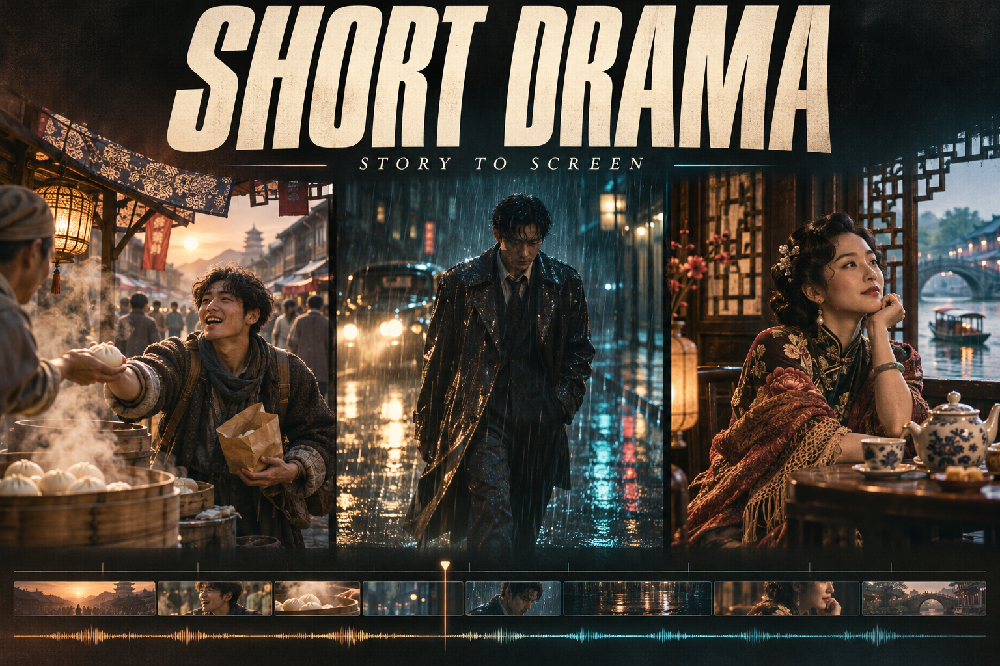
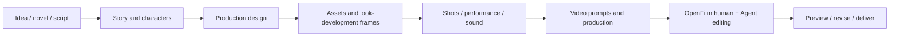

# Short Drama | Give your AI a film crew. 🎬

**Turn a small idea into a short film with character, atmosphere and a reason to keep watching.**

An **Agent Skills workflow for AI short dramas, animated shorts and vertical video**. Story development, production design, storyboards, generation prompts and **OpenFilm visual editing**, connected from story to screen.

[简体中文](README.md) · [Quick start](#-quick-start) · [The skills](#-eleven-skills-one-creative-workflow) · [Validation](docs/VALIDATION.md)



*Concept artwork generated with built-in imagegen. This is a creative direction illustration, not a frame from an H3-generated film.*

## 🔥 Your script says “buy a bun.” The shot can capture a whole morning.

A vendor lifts a bamboo lid. Steam catches the dawn light. Fabric awnings soften the street. Someone brushes past. A bag rustles. Your character accepts breakfast—and their expression earns a moment on screen.

Or take a lonely walk in the rain: a passing car sends headlights across a wet coat and a tired face. Reflections move across the road. Tire noise fades. Rain fills the space again.

**You should not have to write every production detail into the screenplay.** These skills ask the Agent to develop those choices around the story and established characters, record them, and carry them into images, shots, video prompts and postproduction.

## ✨ What makes it different?

### 01 / Audience attention is the creative compass

Why stay for the next shot? Hold the reaction or cut now? Let sound arrive before the image? Shared filmmaking guides connect writing, storyboarding and editing through attention, emotion, expectation and payoff. New topics and major adaptations call for current audience evidence; small revisions reuse the established baseline.

### 02 / Production design that builds a world

Silhouette, hair, makeup, wardrobe texture, lived-in details, spatial geography, foreground and background, props with something to do: the assets stage develops them proactively. Steam, weather, passing traffic, moving light and offscreen sound give the setting a life of its own.

Identity sheets, wardrobe designs, location masters and **character-in-scene look-development frames** have separate jobs. Test whether the person belongs in the world before expanding production.

### 03 / Cinematic craft becomes actionable choices

Color and tone, depth of field, focus, motivated light, diffusion, highlight response, surface texture, sound perspective and continuity have shared guidance. Generation prompts describe concrete objects, changes and outcomes; final looks, grain and shot matching belong in appropriate finishing steps.

The Agent selects techniques for the scene. Complex effects still need an executable shot page or processing implementation: a written look description alone is not a rendered filter.

### 04 / OpenFilm is part of the main workflow

Creative documents, assets and production records live alongside OpenFilm's native viewer, timeline and inspector. **You move a clip. The Agent refines the cut. Both work on the same `film.html`.**

- `film.html` owns shot order, source windows, speed, gain and layers.
- VTT owns sentence-level caption timing, text and styling.
- Shot HTML owns editable graphics and animation.
- The Markdown cut list is a generated report.

Revision checks and locks support collaboration; targeted edits preserve existing manual styling. OpenFilm owns final composition and mixing. Helpers can preprocess source-level EQ, pan and envelopes without introducing a second whole-film render pipeline.

### 05 / Good ideas survive the handoff

Design priorities, sound priorities and source relationships travel downstream. Deleted adopted layers, replaced references and changed creative documents become reviewable issues. Captions map to source timing, with continuous splits handled differently from broken speech coverage. Music ducking can be recalculated after dialogue moves.

Creative omissions remain possible with a recorded reason. Preview supports experimentation; delivery records input and output fingerprints so an old export does not silently stand in for a revised film.

### 06 / The Agent decides. Helpers execute.

Writing and analysis use the current Agent model. Media production follows the project's configured imagegen, MiniMax H3 / RunningHub or other existing routes. `$short-drama` remains the entry point and routes work by task.

No additional standalone WebUI or separate writing/listening model subscription is required by this workflow. Production records support status checks and result collection. When direct listening is unavailable, waveform data can assist—but is not reported as completed listening review.

## 🧭 Story to screen, with continuity between stages



Five readable creative documents hold the upstream work: `剧本.md` (screenplay), `视觉设定.md` (visual design), `分镜.md` (storyboard), `图片提示词.md` (image prompts), and `视频提示词.md` (video prompts). Keep these filenames for the current parsers. OpenFilm files own postproduction. Start from an existing script, footage or an intermediate stage as appropriate.

## 🚀 Quick start

### 1. Install the complete skill suite

Give a local Agent Skills assistant with filesystem and command access this instruction:

```text
Install all 11 short-drama* skills from
https://github.com/Carbon-Glitch/short-drama into your skill discovery directory.
Keep the skill folders as siblings. If customized versions already exist,
compare and back them up first, preserving my changes.
Read short-drama/SKILL.md and report the available creative and production routes.
```

For manual installation:

```sh
git clone https://github.com/Carbon-Glitch/short-drama.git
```

Copy **all 11 root-level `short-drama*` folders** to your host's skills directory. The development setup uses `~/.agents/skills/`; other hosts may use different discovery paths. Install the whole suite because stages reference sibling folders. Reload skills and invoke `$short-drama`.

### 2. Prepare the runtime

| Task | Requirements |
|---|---|
| Writing, analysis and local tools | A local Skills-capable Agent; Python, preferably 3.10+ |
| OpenFilm editing | Node.js + npm, FFmpeg / ffprobe, a working browser runtime, appropriate fonts |
| Image, video and voice generation | Your selected tools, accounts and configuration; generation may incur costs |

From the `short-drama-edit` directory:

```sh
python scripts/openfilm_bridge.py setup
```

The bridge installs pinned `openfilm@0.4.1` into an isolated runtime and deploys the short-drama plugin. Set `SHORT_DRAMA_OPENFILM_HOME` to choose another location. It does not change your global npm registry. Provider credentials stay in your runtime configuration; no keys are included.

### 3. Start directing

```text
$short-drama
Turn this script into a 45-second vertical short. Preserve the story core
and established characters. Develop wardrobe, set dressing, environmental
activity, moving light and sound perspective. Establish visual design and
character-in-scene frames before expanding the shots and generation plan.
Show an exact preview before paid generation. Edit available footage in OpenFilm.
Project directory: <your-project-directory>
```

Or ask for just what you need:

```text
$short-drama Develop production design and audiovisual details for this market scene.
$short-drama Recut this footage around reaction shots, dialogue gaps and musical beats.
$short-drama Open this episode in Studio. I'll adjust captions while you refine the cut.
```

For an existing episode, run from `short-drama-edit`:

```sh
python scripts/edit_tool.py open <episode-directory>
python scripts/edit_tool.py preview <episode-directory>
python scripts/edit_tool.py render <episode-directory>
python scripts/edit_tool.py verify <episode-directory>
```

See the [OpenFilm workflow reference](short-drama-edit/references/openfilm-workflow.md) for initialization, bindings and legacy migration. Use the wrapper commands for formal delivery receipts; Studio's native export menu performs native export only.

## 🧩 Eleven skills. One creative workflow.

| Skill | Responsibility |
|---|---|
| [short-drama](short-drama/SKILL.md) | Entry point, projects and routing |
| [short-drama-develop](short-drama-develop/SKILL.md) | Story engines, relationships, audience evidence and episode development |
| [short-drama-novel-analyze](short-drama-novel-analyze/SKILL.md) | Long-form source analysis and traceable adaptation opportunities |
| [short-drama-write](short-drama-write/SKILL.md) | Shootable scripts, action, dialogue and pacing |
| [short-drama-assets](short-drama-assets/SKILL.md) | Wardrobe, production design, props and environmental life |
| [short-drama-image-prompts](short-drama-image-prompts/SKILL.md) | Identity, wardrobe, location and look-development prompts |
| [short-drama-storyboard](short-drama-storyboard/SKILL.md) | Blocking, framing, performance, coverage and sound relationships |
| [short-drama-video-prompts](short-drama-video-prompts/SKILL.md) | Model-specific prompts, dynamic action and shot handoffs |
| [short-drama-produce](short-drama-produce/SKILL.md) | Preparation, execution, collection and adopted versions |
| [short-drama-edit](short-drama-edit/SKILL.md) | OpenFilm editing, captions, sound and delivery |
| [short-drama-review](short-drama-review/SKILL.md) | Evidence-based story, image, continuity and film review |

## 🔬 Tested execution, clearly scoped

- **Full vertical export:** 35 seconds, 1080 × 1920, 24fps, 840 frames, H.264/AAC.
- **Shared-project editing:** manual native-UI styling survived targeted Agent edits and reopening.
- **Handoffs and audio:** targeted checks covered document changes, deleted layers, replaced sources, caption mapping and music-envelope updates after dialogue moves.
- **Prompt transmission:** three synthetic scenarios carried 22 design decisions into H3 text and offline request fields; 15 writer-context checks covered five modes. Hypit-related checks used the customized local companion; that optional writer patch is not included here.

These results validate execution and information flow, not universal cinematic output or increased audience retention. Fresh-machine deployment remains to be comprehensively tested. Complex legacy effects may need explicit mapping. See [validation notes](docs/VALIDATION.md).

## 🤝 Credits and contribution

[OpenFilm](https://github.com/openfilm/openfilm) supplies native editing and rendering. This repository ships the short-drama workflow, bridge scripts and plugin; its runtime is installed separately through npm. H3 production references [MiniMax H3](https://github.com/MiniMax-AI/MiniMax-H3). See [Hypit](https://github.com/Carbon-Glitch/hypit) for optional reference-driven and companion production workflows.

MoneyPrinterTurbo, OpenMontage and Pixelle-Video were read-only research references for workflow ideas; their repository source was not merged into this release. Third-party software, models and media retain their own terms. Skill source is [MIT licensed](LICENSE). See [artwork provenance and prompt](docs/assets/README.md).

Bring a concrete scene, input, failure and expected result to [Issues](https://github.com/Carbon-Glitch/short-drama/issues), or contribute an improvement. **Make the next short worth remembering.**

AI short drama · AI filmmaking · Agent Skills · vertical video · storyboard · visual development · cinematic prompts · automated video editing · OpenFilm · MiniMax H3 · RunningHub · AI短剧 · 漫剧 · 分镜 · 自动剪辑
