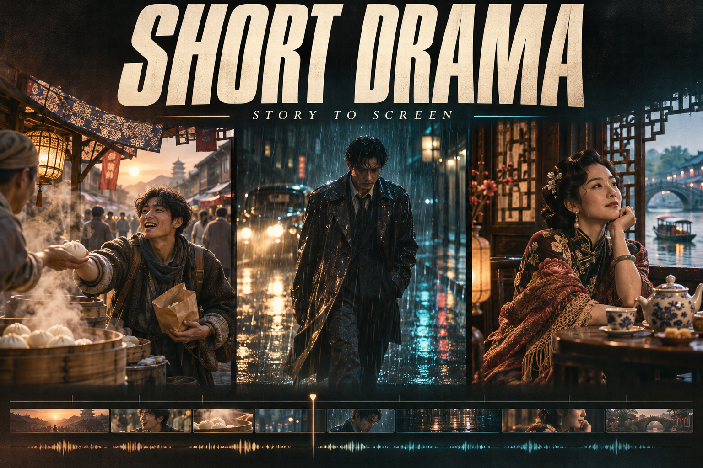

# Short Drama｜让 AI 开机，让故事入戏 🎬

**从一句灵感，到一条有戏、有景、有声音层次的短片。**

面向 **AI 短剧、漫剧与竖屏短视频**的 Agent Skills 工作流：把剧情开发、人物妆造、场景美术、分镜、生成提示词与 **OpenFilm 可视化剪辑**连成一条创作链。

[English](README.en.md) · [快速开始](#-快速开始) · [12 个技能](#-一支装进-agent-的剧组) · [验证范围](docs/VALIDATION.md)



*内置 imagegen 生成的概念封面，展示创作方向；非 H3 成片截图。*

## 本地导演台协作（可选）

本仓库以 **12 个 Skill** 为主，也提供 `director-desk/` 源码，供你与 Agent 在浏览器里编辑剧本、视觉设定、分镜、参考素材与视频提示词，并进入 OpenFilm 剪辑。

已安装 Python 3.11+、Node.js 22.12+ 和 npm 的 Windows 用户，克隆或下载完整仓库后，双击 `director-desk/Start-Director-Desk.cmd`。首次启动会安装前端依赖并构建界面，需要联网；以后直接打开。导演台默认使用仓库内的 Skill，无需先复制到个人技能目录。

纯 Skill 使用按下方快速开始安装。导演台中自动改稿另需已登录的 Codex CLI；剪辑需 FFmpeg/ffprobe 与 OpenFilm；生成服务使用你自己的账号与配置。当前提供源码，不发布安装包。

[导演台使用说明](director-desk/README.md) · [已验证范围](director-desk/VALIDATION.md)

## 🔥 剧本写了“买个馒头”，镜头可以拍出整个早晨

你给一句：**“男主逛早市，买了个馒头。”**

我们希望 Agent 想到的还有：蒸笼掀开的热气、摊主熟练的手势、被晨光照透的棚布、擦肩而过的人、塑料袋的窸窣声，以及男主接过馒头时那个值得留下的表情。

你写：**“雨夜，一个失意的人独自走着。”**

镜头可以让一辆车从画外经过，车灯扫过湿衣和脸，倒影滑过路面，胎噪离开后，雨声重新占满空间。

**这些不是要求你把剧本写成百科全书。它们是 Skill 应该主动补上的导演与美术工作。** 补充围绕故事内核和角色设定展开，记入上游文档，再传给资产图、分镜、视频提示词和后期。

## ✨ 这套工作流，强在哪里？

### 01 / 让观众愿意看，才是第一件事

开场为什么停留？一个反应该多留半拍，还是直接切走？钩子何时兑现，兑现后又产生什么新期待？剧情事件、人物行动与视听母题共同提供观看回报，密度不等于碎切。分镜之后、资产与提示词之前还有一轮轻量导演体验审读，保留最强处，先修最影响观看的问题。新选题与重大改编会复核现实观众证据，局部润色沿用已有基线。

### 02 / 美术会主动“加戏”，但记得自己加过什么

角色有轮廓、妆发、材质与生活痕迹；空间有地理、前中后景、陈设和可表演的道具。环境也有自己的生命：蒸汽、风、雨、过路人、动态光源和画外声。

默认以**人物/造型、场景和关键道具的最小主体资产**配合全能参考与文本导演。代表图、关键状态细节图和逐切关键帧按实际控制需要补充，不再默认生成一整套中间帧。

### 03 / 高级感拆成能执行的决定

色彩与影调、景深、焦点、光源动机、扩散与高光、材质纹理、空间声音、跨镜一致性，都有默认知识支撑。Agent 将适合生成端的设计写成具体对象、变化和结果；Look/LUT、最终颗粒、镜间匹配等留给适合的后期处理。

**高级感来自选择。** 每个场面选需要的手法，不给所有片子套同一层滤镜。复杂效果仍需落实为可执行的镜头页或处理方案，文字描述本身不等于滤镜已经渲染。

### 04 / OpenFilm 已经进入主流程

前期文档、素材与生产记录进入同一 Studio；原生 viewer、timeline、inspector 承接剪辑。**你拖时间线，Agent 改镜头，两边围绕同一个 `film.html` 工作。**

- `film.html`：镜序、素材窗口、速度、音量与图层。
- VTT：逐句字幕时间、文字与版式。
- 镜头 HTML：可编辑图形和动画。
- `剪辑单.md`：自动生成的报告。

版本检查与锁定支持协作，局部修改保留已有人工样式。OpenFilm 负责最终合成；源音轨的 EQ、声像和包络由 helper 预处理后交给它混音。

### 05 / 前期的好点子，要真的走到后期

设计重点、声音重点和来源关联沿流程传递。采用的图层被删除、参考换版、前期文档修改，都会留下待复核信息。字幕跟随来源时间映射，连续拆片与不连续切割分别处理；对白移动后可重算音乐让位。

创作中可以有意舍弃设计，并记录原因。预览支持边试边改；正式交付核对输入与输出指纹，识别“上游改了，成片还是旧版”。

### 06 / Agent 做判断，helper 干执行

创作与分析使用当前 Agent 的模型；沿用项目已配置的 imagegen、MiniMax H3 / RunningHub 等生产路线。入口仍是 `$short-drama`，按任务路由到阶段技能。可直接使用 Skill，也可用仓库自带导演台协作；不要求额外订阅一个写作或听审模型。

生产有任务记录，可继续查询与收集结果；无法直接听审时，波形等数据辅助判断，并明确声音验收尚未完成。

## 🎨 剧本之后，先设计一个值得看的世界

**[short-drama-design：体验与视觉总设计](short-drama-design/SKILL.md)**先确定观众入口、情感心脏、持续期待与知情差，再发展人物妆造、空间道具、新调度与成像。近期原作研究和跨作品组合按当前设计问题使用，随后交给文本分镜落实。

画面可以精致丰盛，也可以极简克制；强度随内容、观众与项目规格选择。钩子沿剧情、人物和视听三层接力，每次兑现产生后果并形成下一期待，不靠重复证据或镜头数量制造密度。写实与手机拍摄质感同样可以承载大胆的形态、色彩和物品行为。

设计可以补充剧本未写的事件、环境干扰、沉默、屏幕动图与声音落点，围绕观众情绪节奏取舍。场面设计与人物/场景设定同存于 `视觉设定.md`，原剧本和新增设计一起交给下游。

分镜或本次所需的实际资产图缺一项，先执行设计。`design_tool.py inspect/complete` 记录来源版本，完成后接续下游；已有设计复用，来源变化再更新，避免循环。分镜后先做导演体验审读，再展开最小主体资产和提示词，不另建审查文档。

## 🎞️ 在分镜时，就为下一次切镜做好准备

分镜现在区分 **SHOT（观众看到的镜头）**与 **clip（一次模型调用）**：按实际模型和应用能力，提前安排调用次数、每段内容、生成预算与接法。**默认 H3 尽量 13–15 秒一个 clip，Seedance 2.5 在内容适合时优先接近 30 秒**；同次调用内可包含多个分镜，结合实际接口、对白、动作与自然段落调整。这是制作偏好，不是时长越长效果必然越好的保证。景别变化、30°参照、动作匹配、反应镜、气口与声音桥都是导演可选手法，不是僵硬禁令。

「生成安排／接镜」会传到提示词、生产和 OpenFilm 交接信息。预览与正式导出自动附带 **接点回看页**，直接播放同一成片，支持边界附近循环和逐帧查看，显示源窗与镜头来源。它帮助发现问题，不把机械检查当成审美验收。

已有导出可用 `python scripts/openfilm_bridge.py seams <集目录> --preview` 重建预览接点页（在 `short-drama-edit` 目录运行，正式版省略 `--preview`）。详见 [模型分段与接镜指南](short-drama/references/model-aware-coverage-and-joins.md)。本轮验证了规划传递与回看工具，尚未用新 H3 生成对比证明接缝改善；当前 RunningHub 调用与视频参考策略保持不变。

## 🧭 从故事到成片，每一步接得上


前期保留五份可读主稿：`剧本.md`、`视觉设定.md`、`分镜.md`、`图片提示词.md`、`视频提示词.md`。后期以 OpenFilm 工程为主稿。你可以从已有剧本、现成素材或中间阶段进入，不必为了走流程补写无用文档。

## 🚀 快速开始

### 1. 把完整技能组装进 Agent

将下面这段发给支持本地 Agent Skills、文件读写和命令执行的助手：

```text
请安装 https://github.com/Carbon-Glitch/short-drama 的全部 12 个 short-drama* 技能，
放到你的技能发现目录，保持这些目录互为同级。
如果已有个性化版本，先比较并备份，保留我的修改。
读 short-drama/SKILL.md，然后告诉我当前可用的创作与生产路线。
```

手动安装先克隆：

```sh
git clone https://github.com/Carbon-Glitch/short-drama.git
```

把仓库根目录的 **全部 12 个 `short-drama*` 文件夹**放进宿主的技能目录。本机采用 `~/.agents/skills/` 共享安装；其他宿主以其技能发现规则为准。各阶段会引用同级目录，别只装入口。重载技能后用 `$short-drama` 开始。

### 2. 准备执行环境

| 用途 | 需要什么 |
|---|---|
| 创作、分析、文件处理 | 支持本地 Skills 和工具调用的 Agent；Python（建议 3.10+） |
| OpenFilm 后期 | Node.js + npm、FFmpeg / ffprobe、可用的浏览器运行环境；中文字体 |
| 图片 / 视频 / 配音生产 | 项目选择的工具、对应账号与配置；媒体生成可能产生费用 |

从 `short-drama-edit` 目录初始化隔离后期运行时：

```sh
python scripts/openfilm_bridge.py setup
```

桥接器安装固定的 `openfilm@0.4.1` 并部署短剧插件。可用 `SHORT_DRAMA_OPENFILM_HOME` 指定运行时位置；不修改 npm 全局镜像。生产接口的配置与凭据留在运行环境，仓库不附带 Key。

### 3. 直接开拍

```text
$short-drama
把这份剧本做成 45 秒竖屏短片。保留角色和故事内核，
主动补充妆造、空间陈设、环境活动、动态光影和声音层次。
先设计观众期待与兑现，再完成文本分镜、导演体验审读和最小主体资产。
需要实际付费生成时给我精确预览；素材齐了就在 OpenFilm 里剪。
项目放到：<你的项目目录>
```

也可以只做一段：

```text
$short-drama 帮我丰富这场早市戏的美术和视听设计，先不生成。
$short-drama 保留这些现有素材，把对白间隙、反应镜头和音乐落点重新剪顺。
$short-drama 打开这一集的 OpenFilm 创作台，我想自己调字幕，你接着精剪。
```

已有工程的后期命令（在 `short-drama-edit` 目录执行）：

```sh
python scripts/edit_tool.py open <集目录>
python scripts/edit_tool.py preview <集目录>
python scripts/edit_tool.py render <集目录>
python scripts/edit_tool.py verify <集目录>
```

初始化、来源绑定和旧工程迁移见 [OpenFilm 工作流](short-drama-edit/references/openfilm-workflow.md)。正式交付走上述包装入口，以生成 short-drama 的交付记录；Studio 自带导出菜单只进行原生导出。

## 🧩 一支装进 Agent 的剧组

| Skill | 职责 |
|---|---|
| [short-drama](short-drama/SKILL.md) | 统一入口、项目与阶段路由 |
| [short-drama-develop](short-drama-develop/SKILL.md) | 故事引擎、人物关系、受众证据与分集开发 |
| [short-drama-novel-analyze](short-drama-novel-analyze/SKILL.md) | 长篇原著、改编价值与可追溯分析 |
| [short-drama-write](short-drama-write/SKILL.md) | 可拍剧本、行动、对白与节奏 |
| [short-drama-design](short-drama-design/SKILL.md) | 观众体验、视觉设计、新调度与情绪节奏 |
| [short-drama-assets](short-drama-assets/SKILL.md) | 最小主体资产、参考用途与实际采用图 |
| [short-drama-image-prompts](short-drama-image-prompts/SKILL.md) | 人物/造型、场景、关键道具与按需控制图片 |
| [short-drama-storyboard](short-drama-storyboard/SKILL.md) | 期待与注意路径、镜头调度、表演与声画关系 |
| [short-drama-video-prompts](short-drama-video-prompts/SKILL.md) | 目标模型提示词、动态过程与镜头交接 |
| [short-drama-produce](short-drama-produce/SKILL.md) | 生产准备、执行、结果收集与版本登记 |
| [short-drama-edit](short-drama-edit/SKILL.md) | OpenFilm 初剪、精剪、字幕、声音与交付 |
| [short-drama-review](short-drama-review/SKILL.md) | 分镜后导演体验审读与实际作品质量复核 |

## 🔬 有实测，也把实测边界说清楚

- **完整竖屏导出**：35 秒、1080 × 1920、24fps、840 帧、H.264/AAC。
- **同工程协作**：原生 UI 修改样式后，Agent 局部编辑、重新打开，人工样式保留。
- **交接与声音**：文档变更、图层删除、来源替换、字幕映射及对白移动后的音乐包络经过针对性验证。
- **提示词传递**：三个合成场景、22 项设计进入 H3 正文与离线请求；15 项写作上下文检查覆盖五种模式。涉及 Hypit 的检查使用本机配套版本，该可选 writer 补丁不在本仓库中。

这些证明执行链与信息传递，不代表所有题材都完成动态画质测试，也不代表观众留存提升。新机器部署仍需验证；复杂旧效果可能需要手动映射。详见 [验证说明](docs/VALIDATION.md)。

## 🤝 致谢与开放协作

[OpenFilm](https://github.com/openfilm/openfilm) 提供原生编辑与渲染基础，本仓库提供短剧创作工作流、适配脚本和插件，运行时通过 npm 单独安装。H3 生产参考 [MiniMax H3](https://github.com/MiniMax-AI/MiniMax-H3)；可选的参考复刻与配套生产工作流见 [Hypit](https://github.com/Carbon-Glitch/hypit)。

MoneyPrinterTurbo、OpenMontage、Pixelle-Video 等只读调研用于学习流程组织思想，未将它们的仓库源码并入本次发布。第三方软件、模型与素材遵循各自许可；本技能源码采用 [MIT](LICENSE)。封面来源与完整提示词见 [配图说明](docs/assets/README.md)。

欢迎带着具体场景、输入、失败现象与期望结果提 [Issue](https://github.com/Carbon-Glitch/short-drama/issues)，也欢迎提交改进。**让下一条短片，多一点值得被记住的东西。**

AI short drama · AI filmmaking · Agent Skills · vertical video · storyboard · visual development · cinematic prompts · automated video editing · OpenFilm · MiniMax H3 · RunningHub · AI短剧 · 漫剧 · 分镜 · 资产设计 · 自动剪辑
